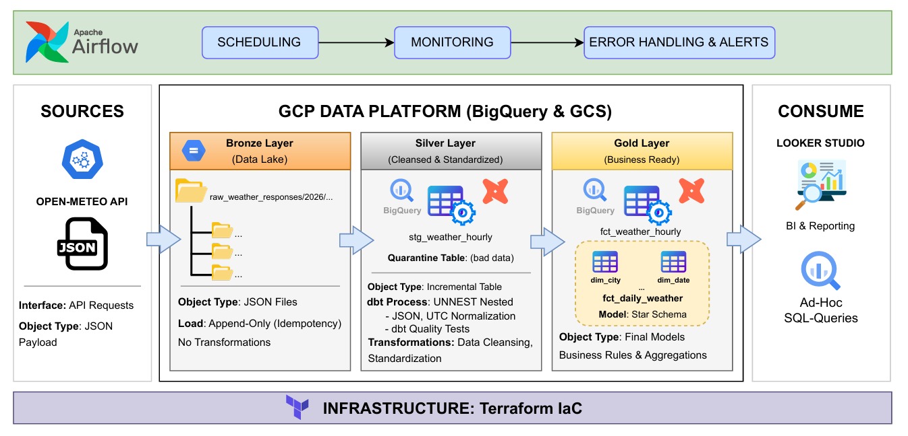
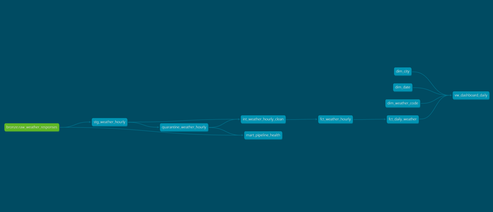
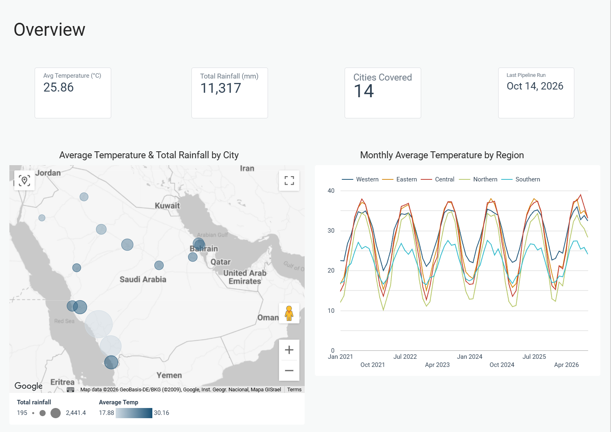
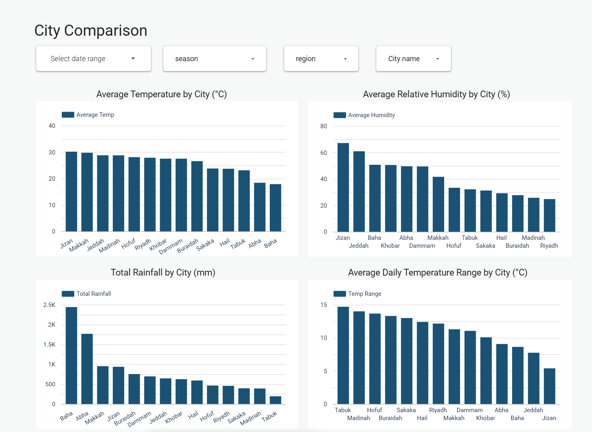
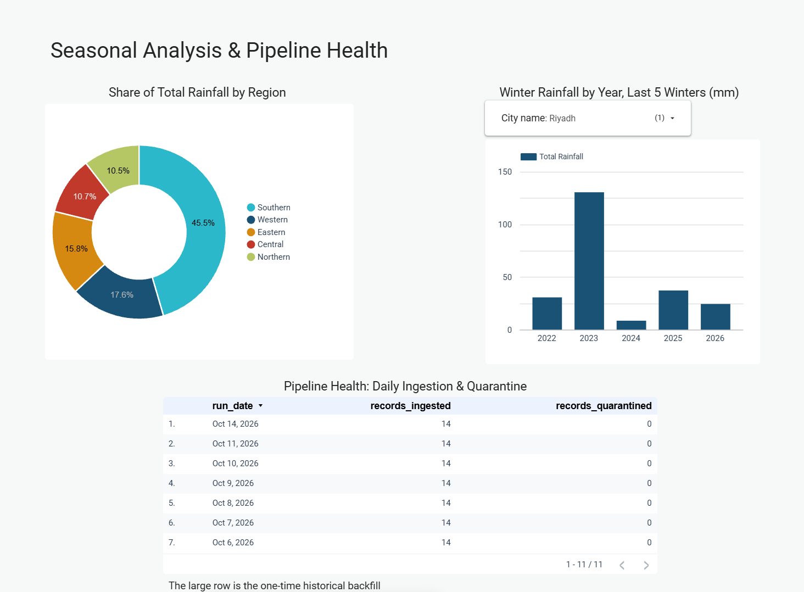

# 🌤️ Saudi Arabia Weather Analytics & Data Engineering Pipeline


## 📌 Project Overview & Problem Statement
Analyzing climate patterns across Saudi Arabia requires reliable, historical, and daily-updated meteorological data spanning diverse geographical regions. Raw weather APIs return deeply nested JSON structures, are prone to network timeouts during batch extraction, and lack built-in data quality guarantees.

This project implements an end-to-end, production-grade **ELT Data Engineering Pipeline** that extracts historical (2021–Present) and daily weather observations for **14 major Saudi cities**. Using the **Medallion Architecture (Bronze, Silver, Gold)** on Google Cloud Platform (BigQuery), the pipeline automates ingestion via **Apache Airflow**, enforces strict data contracts, deduplication, and anomaly quarantining via **dbt**, provisions cloud infrastructure via **Terraform**, and delivers actionable climate and pipeline-observability insights through a 3-page **Looker Studio** dashboard.

🔗 **[Explore the Live Looker Studio Dashboard](https://datastudio.google.com/reporting/d8a1eccb-1025-4494-9730-15dbc2ff7eb2)**

---

## 🏗️ System Architecture & Data Lineage

### 1. High-Level System Architecture
> 

### 2. Detailed dbt Data Lineage (Medallion Flow)
The transformation layer follows a strict modular DAG inside BigQuery, separating main analytical processing from quarantine auditing and pipeline health observability:

> 

### Step-by-Step Data Flow:
1. **Ingestion (Airflow ➔ Bronze):** An Airflow DAG queries the Open-Meteo API for 14 Saudi cities and loads the raw JSON payloads into `bronze.raw_weather_responses` (append-only).
2. **Staging & Deduplication (Bronze ➔ Silver):** `stg_weather_hourly` incrementally extracts only new payloads, deduplicates intra-batch retries via `QUALIFY ROW_NUMBER()`, and flattens the nested hourly arrays (`UNNEST WITH OFFSET`).
3. **Quarantine & Filtering (Silver ➔ Silver):**
   * `quarantine_weather_hourly` scans staged records and captures any rows violating domain quality rules.
   * `int_weather_hourly_clean` takes the staged data, excludes quarantined records, and outputs strictly validated hourly observations.
4. **Observability Branch (Bronze + Silver ➔ Gold):** `mart_pipeline_health` joins `bronze.raw_weather_responses` with `quarantine_weather_hourly` to calculate daily `records_ingested` vs. `records_quarantined` per `run_date`.
5. **Star Schema & BI Serving (Silver ➔ Gold):** Validated hourly data flows into `fct_weather_hourly` and aggregates into `fct_daily_weather`. Finally, `vw_dashboard_daily` joins `fct_daily_weather` with three dimensional tables (`dim_city`, `dim_date`, `dim_weather_code`) to power the Looker Studio dashboard.

---

## 🥉🥈🥇 Data Dictionary & Modeling Details

### 1. Bronze Layer (Raw Landing)
- **`raw_weather_responses`**: Append-only landing table storing raw JSON responses alongside ingestion metadata (`city_id`, `request_date`, `pulled_at`, `payload`).

### 2. Silver Layer (Cleansed, Standardized & Quarantined)
- **`stg_weather_hourly`**: Incremental table (`incremental_strategy='merge'`, `unique_key=['city_id', 'observed_at_utc']`) that parses JSON arrays (`time`, `temperature_2m`, `relative_humidity_2m`, `precipitation`, `wind_speed_10m`, `weather_code`) into typed columns.
- **`quarantine_weather_hourly`**: Isolates anomalous or corrupted weather observations for auditing without halting pipeline execution.
- **`int_weather_hourly_clean`**: Clean intermediate model feeding downstream fact tables.

### 3. Gold Layer (Business-Ready Star Schema & Observability)
- **Fact Tables:**
  * **`fct_weather_hourly`**: Granular hourly weather facts across all 14 cities.
  * **`fct_daily_weather`**: Daily city-level aggregations (avg/min/max temperatures, daily temperature range, total precipitation, avg relative humidity, and dominant weather code).
- **Dimension Tables:**
  * **`dim_city`**: City metadata, geographic coordinates (latitude/longitude), and macro-regional classifications (`Central`, `Eastern`, `Western`, `Northern`, `Southern`).
  * **`dim_date`**: Calendar attributes, seasons (`Winter`, `Spring`, `Summer`, `Autumn`), and `season_year` mappings.
  * **`dim_weather_code`**: WMO weather code descriptions and weather condition groupings.
- **Marts & BI Views:**
  * **`mart_pipeline_health`**: Tracks daily ingestion volume and quarantine counts.
  * **`vw_dashboard_daily`**: Denormalized wide view joining `fct_daily_weather` with `dim_city`, `dim_date`, and `dim_weather_code` for high-performance BI querying.

> **🌍 Geospatial Note (Dammam & Khobar):** Among the 14 monitored cities, **Dammam** and **Khobar** are geographically adjacent in the Eastern Province with closely proximate coordinates. While their macro-level weather trends closely align, both cities are tracked independently across the pipeline and dimensional model to preserve city-level granularity and demographic completeness on the dashboard.

---

## 🛠️ Engineering Case Study: Catching & Resolving Intra-Batch Duplication

A core design goal of this project is **Pipeline Observability** and **Idempotency**—ensuring that task failures and retries never corrupt downstream analytics. During production testing, a real-world data engineering incident occurred, was surfaced by our observability tools, and was permanently resolved:

### 1. The Incident (What Happened?)
The Airflow ingestion DAG is designed to pull 14 records daily (one JSON payload per Saudi city) into the append-only Bronze table (`raw_weather_responses`). On **October 8, 2026**, a transient network issue triggered an **Airflow task retry**. Because the Bronze layer is append-only, one city's payload was ingested twice within the same batch—resulting in **15 ingested records** instead of 14.

### 2. How the Pipeline Detected It
The anomaly was caught immediately across two independent defense layers:
1. **Observability Dashboard (`mart_pipeline_health`):** On Page 3 of the Looker Studio dashboard, the daily ingestion monitor explicitly flagged `records_ingested = 15` on Oct 8, 2026 (deviating from the expected baseline of `14`), exposing the duplicate pull in the Bronze layer.
2. **Automated dbt Testing (`dbt build`):** When `stg_weather_hourly` unnested the duplicate city payload, it generated **24 duplicate hourly rows** (1 day × 24 hours) with identical `(city_id, observed_at_utc)` keys. This immediately tripped the `dbt_utils.unique_combination_of_columns` test (`Got 24 results, configured to fail if != 0`) and prevented corrupted data from reaching the Gold layer.

### 3. Root Cause & Resolution
While `stg_weather_hourly` was configured with `incremental_strategy='merge'` to prevent duplicates *between* historical table data and new runs, BigQuery `MERGE` cannot resolve duplicates that exist *within the incoming source batch itself* (intra-batch duplication).

To make the Silver staging layer strictly idempotent against Airflow retries, we implemented a window-function deduplication filter directly on the source CTE before array unnesting:

```sql
WITH source_data AS (
    SELECT
        city_id,
        request_date,
        pulled_at,
        payload
    FROM {{ source('bronze', 'raw_weather_responses') }}

    
    WHERE pulled_at > (SELECT MAX(pulled_at) FROM {{ this }})
    

    -- Guarantee intra-batch idempotency by retaining only the latest pull per city/date
    QUALIFY ROW_NUMBER() OVER (
        PARTITION BY city_id, request_date
        ORDER BY pulled_at DESC
    ) = 1
)
```
Following this fix, executing `dbt build --select stg_weather_hourly --full-refresh` purged the legacy duplicate rows, passed all 30 model and data tests, and restored the pipeline health table to a clean `14` records per day.

---

## 📊 Dashboard Preview (Looker Studio)

🔗 **[Live Interactive Dashboard](https://datastudio.google.com/reporting/d8a1eccb-1025-4494-9730-15dbc2ff7eb2)**

### Page 1: Overview
Displays macro-level KPIs (`Avg Temperature: 25.86°C`, `Total Rainfall: 11,317 mm`, `Cities Covered: 14`, `Last Pipeline Run`), a geospatial bubble map of Saudi Arabia encoding both rainfall volume (bubble size) and temperature (color gradient), and a multi-year time series of monthly average temperatures across all 5 regions.
> 

### Page 2: City Comparison
Interactive cross-filtering by date range, season, region, and city name, featuring ranked bar charts for Average Temperature (°C), Average Relative Humidity (%), Total Rainfall (mm), and Average Daily Temperature Range (°C).
> 

### Page 3: Seasonal Analysis & Pipeline Health
Breaks down regional rainfall share (Southern region leading at 45.5%), tracks Winter Rainfall across the last 5 winters (`2022–2026`), and features the **Pipeline Health: Daily Ingestion & Quarantine** audit table.
> 

---

## 📂 Repository Structure

```bash
.
├── LICENSE
├── README.md
├── docs/
│   └── image/                      # Architecture, lineage, and dashboard screenshots
│       ├── architecture.png
│       ├── dbt_lineage.png
│       ├── dashboard_page1_overview.jpg
│       ├── dashboard_page2_cities.jpg
│       └── dashboard_page3_health.jpg
├── airflow/                        # Airflow configurations & DAG definitions
│   ├── airflow.cfg
│   └── dags/
│       └── weather_pipeline.py
├── keys/                           # GCP Service Account JSON keys (gitignored)
├── terraform/                      # Terraform IaC for GCP BigQuery provisioning
│   ├── main.tf
│   ├── variables.tf
│   └── terraform.tfvars
└── weather_transform/              # dbt Core project
    ├── dbt_project.yml
    ├── packages.yml
    ├── models/
    │   ├── silver/
    │   │   ├── stg_weather_hourly.sql
    │   │   ├── int_weather_hourly_clean.sql
    │   │   ├── quarantine_weather_hourly.sql
    │   │   ├── schema.yml
    │   │   └── sources.yml
    │   └── gold/
    │       ├── dim_city.sql
    │       ├── dim_date.sql
    │       ├── dim_weather_code.sql
    │       ├── fct_weather_hourly.sql
    │       ├── fct_daily_weather.sql
    │       ├── mart_pipeline_health.sql
    │       └── vw_dashboard_daily.sql
    ├── seeds/                      # City coordinates & regional lookup seeds
    └── tests/                      # Custom data tests
```

---

## 🚀 How to Run Locally

### 1. Prerequisites & GCP Credentials
1. Create a Google Cloud Project and a **Service Account** with `BigQuery Admin` (or `BigQuery Data Editor` & `BigQuery Job User`) roles.
2. Download the Service Account JSON key and place it inside the `keys/` directory (e.g., `keys/pipeline-sa.json`).

---

### 2. Provision Infrastructure (Terraform)
```bash
cd terraform
terraform init
terraform apply
```

---

### 3. Configure & Run dbt Transformations
1. Create a `profiles.yml` file inside `weather_transform/` (or `~/.dbt/profiles.yml`) to connect dbt with BigQuery using your Service Account key:

```yaml
weather_transform:
  target: dev
  outputs:
    dev:
      type: bigquery
      method: service-account
      project: YOUR_GCP_PROJECT_ID
      dataset: weather_silver
      threads: 4
      keyfile: /full/path/to/weather-pipeline-project/keys/pipeline-sa.json
      location: US # or your specific GCP dataset region (e.g., me-central2)
```

2. Install dbt packages and execute the models and tests:

```bash
cd weather_transform
dbt deps

# Run full refresh on initial setup or after schema changes
dbt build --full-refresh

# Standard incremental daily build & test execution
dbt build
```

---

### 4. Configure & Start Apache Airflow
1. Export your environment variables and start Airflow from the root project directory:

```bash
export AIRFLOW_HOME=$(pwd)/airflow
export GOOGLE_APPLICATION_CREDENTIALS=$(pwd)/keys/pipeline-sa.json

# Start Airflow services
airflow standalone
```

2. **Configure the `google_cloud_default` Connection in Airflow:**
   * **Option A (Via CLI - Recommended):**
     ```bash
     airflow connections add 'google_cloud_default' \
         --conn-type 'google_cloud_platform' \
         --conn-extra '{"project": "YOUR_GCP_PROJECT_ID", "key_path": "'$(pwd)'/keys/pipeline-sa.json"}'
     ```
   * **Option B (Via Airflow Web UI):**
     1. Open the Airflow UI (`http://localhost:8080`).
     2. Navigate to **Admin** ➔ **Connections**.
     3. Edit (or create) **`google_cloud_default`**:
        * **Connection Type:** `Google Cloud`
        * **Project ID:** `<YOUR_GCP_PROJECT_ID>`
        * **Keyfile Path:** `/full/path/to/weather-pipeline-project/keys/pipeline-sa.json`

## 👨‍💻 About Me

Hi, I'm **Nadim Alhoshani**, a senior Computer Science student at **King Saud University** with a profound passion for **Data Engineering** and building robust, scalable data architectures. 

I enjoy tackling complex data challenges, designing efficient ETL/ELT pipelines, and transforming raw, fragmented data into actionable business insights. I'm constantly exploring new technologies, cloud platforms, and distributed data processing frameworks to stay at the forefront of the data ecosystem.
